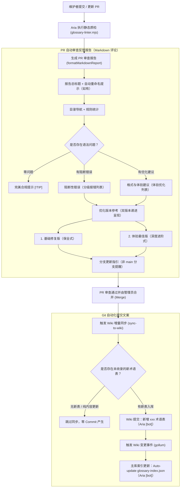

# AO3 Translator 自动化文案与交互规范手册

本手册汇集了在线术语表审查、Wiki 自动收录及索引更新全流程中**所有可能出现的文案（含标题、提示语、正文及提交信息）**，并详细说明各文案的**触发条件、层级关系与逻辑递进**。

---

## 整体文案架构与流转时序



---

## 第一部分：PR 自动审查反馈文案体系

### 1. 报告顶层标题与重命名通知

#### 1.1 报告顶层主标题
* **层级关系**：整个审查反馈评论的 `H2` 顶层标题。
* **分支递进**：
  * **单文件审查**（最常见）：
    ```markdown
    ## {文件名（去除.txt）} - 自动审查报告
    ```
    *示例*：`## Formula 1 RPF - 自动审查报告`
  * **多文件批量审查**（同一 PR 提交了多个术语表）：
    ```markdown
    ## 在线术语表 - 自动审查报告
    ```

#### 1.2 自动修复记录（文件后缀补全通知）
* **层级关系**：紧随主标题之后，处于前置说明位置。
* **触发条件**：贡献者上传的文件名缺少 `.txt` 后缀（如命名为 `Formula 1 RPF` 或 `F1.json`），但文件实质为纯文本术语表，系统自动在分支中补全 `.txt` 时触发。
* **文案模板**：
  ```markdown
  > [!NOTE]
  > **自动修复记录**：
  > 
  > - 检测到文件 `{oldName}` 缺少 `.txt` 后缀，已自动补充并重命名为 `{newName}`。
  ```

---

### 2. 目录导航与规则统计

#### 2.1 目录导航 (TOC)
* **层级关系**：提供整篇长评论的快速跳锚。
* **触发与递进条件**：**自适应动态渲染**。仅在对应模块有内容时才会生成该导航项，无内容则不显示，保持界面清爽。
* **文案模板**：
  ```markdown
  ### 目录

  - 规则统计
  - 阻断性错误             <!-- 仅在 errors.length > 0 时生成 -->
  - 格式与体验建议         <!-- 仅在 warnings.length > 0 时生成 -->
  - 优化版本参考           <!-- 仅在 errors 或 warnings > 0 时生成 -->
    - 1\. 基础修复版
    - 2\. 体验最佳版
  - 分支更新建议           <!-- 仅在贡献分支非 main 时生成 -->
  ```

#### 2.2 规则统计
* **层级关系**：位于报告首屏，让作者一目了然确认所有分区的解析体量。
* **触发条件**：无论有无错误，必然生成。
* **文案模板**：
  ```markdown
  ### 规则统计

  词条区：{terms} 条，通用词条区：{generalTerms} 条，禁翻词条区：{forbiddenTerms} 条，正则表达式：{regexTerms} 条。
  ```

---

### 3. 完美合规状态提示

* **层级关系**：替代“阻断性错误”与“格式与体验建议”。
* **触发条件**：`errors.length === 0 && warnings.length === 0`（完全符合 AOT 客户端解析标准且书写完美）。
* **文案模板**：
  ```markdown
  > [!TIP]
  > 该术语表编写极其规范，未发现任何格式语法问题，符合 AOT 客户端解析标准！
  ```

---

### 4. 阻断性错误（Blocking Errors）

* **定义与性质**：**硬性语法阻断**。此类错误会导致 AOT 客户端直接跳过该行（`result.dropped++`）、静默丢失翻译规则，或导致解析崩溃。PR 必须修复方能生效。
* **显示格式**：标注命中处数，并以代码块附带所有问题行原文。**单项时不带序号，多项时采用递增数字序号**。
* **四层分级递进排列顺序**（由全局到局部，由语法丢弃到正则风险）：

| 分级层级 | 序号 | 错误类别 Key | 触发条件 | 完整文案模板 |
| :--- | :---: | :--- | :--- | :--- |
| **一、全局文件与元数据错误**<br>*(影响整个文件读取与版本识别)* | 1 | `file_ext` | 术语表文件后缀不是 `.txt` | `文件后缀不符合规范（共 {N} 处）：` |
| ^ | 2 | `missing_section` | 文件未包含任何有效分区标题（词条/通用词条/禁翻词条/正则表达式） | `文件缺少有效分区标题（共 {N} 处）：` |
| ^ | 3 | `missing_version` | 文件顶部元数据缺少 `版本号：` 或 `version:` | `元数据缺失版本号（共 {N} 处）：` |
| ^ | 4 | `missing_maintainer` | 文件顶部元数据缺少 `维护者：` 或 `maintainer:` | `元数据缺失维护者（共 {N} 处）：` |
| ^ | 5 | `version_not_bumped` | 修改已有术语表时，新版本号小于或等于当前主分支版本 | `版本号未递增（共 {N} 处）：` |
| **二、规则级致命语法错误**<br>*(客户端无法定位连接符或关联符，整行被静默丢弃)* | 6 | `whole_line_quoted` | 引号错误包裹了整条规则（如 `"Ferrari = 法拉利"`），客户端定位不到连接符而整行丢弃 | `引号包裹了整条规则（共 {N} 处）：` |
| ^ | 7 | `unquoted_apostrophe` | 规则原文包含撇号/引号（`'`、`‘`、`"`、`“` 等），但未用成对引号包裹导致解析截断丢弃 | `规则原文包含撇号/引号但未用引号包裹（共 {N} 处）：` |
| ^ | 8 | `unquoted_dangerous_punc` | 规则原文自身包含连接符 `:` 或关联符 `=`，但未包裹引号导致语法截断 | `规则原文包含连接符 \`:\` 或关联符 \`=\` 但未用引号包裹（共 {N} 处）：` |
| ^ | 9 | `missing_separator` | 词条行缺少有效的 `:` 连接符或 `=` 关联符 | `规则缺失连接符 \`:\` 或关联符 \`=\`（共 {N} 处）：` |
| **三、词条语义与格式错误**<br>*(并列符号混淆与不当拆分)* | 10 | `slash_in_key` | 普通词条原文中包含斜杠 `/` 表示并列 | `规则原文包含斜杠 \`/\`（共 {N} 处）：` |
| ^ | 11 | `forbidden_slash_in_key` | 禁翻词条区单行中包含斜杠 `/` | `禁翻词条中包含斜杠 \`/\`（共 {N} 处）：` |
| **四、正则表达式专区错误**<br>*(引发正则死循环或客户端假死崩溃)* | 12 | `regex_syntax` | 正则表达式语法非法，无法通过 `new RegExp` 编译 | `正则表达式语法非法（共 {N} 处）：` |
| ^ | 13 | `regex_empty_match` | 正则表达式能够匹配空字符串（会导致无限循环死锁） | `正则表达式能匹配空字符串（共 {N} 处）：` |
| ^ | 14 | `regex_redos` | 正则表达式包含嵌套贪婪量词（存在 ReDoS 假死崩溃风险） | `正则表达式包含嵌套量词（共 {N} 处）：` |
| ^ | 15 | `regex_missing_sep` | 正则表达式分区中的规则缺少冒号连接符 | `正则表达式缺少冒号连接符（共 {N} 处）：` |

---

### 5. 格式与体验建议（Formatting & UX Recommendations）

* **定义与性质**：**非阻断性建议**。客户端虽能读取，但格式不标准、未发挥 AOT 最佳分词效果、或排版有瑕疵。不阻断合并，但推荐修正。
* **显示格式**：标注命中处数。**单项时不带序号，多项时采用递增数字序号**。
* **文案递进与关系**：每一项建议文案均配有对应的**修复动作说明**，直接与后文“体验最佳版”的修改点一一对应。

| 序号 | 建议类别 Key | 触发条件 | 建议标题文案 | 对应体验最佳版动作说明 |
| :--- | :--- | :--- | :--- | :--- |
| 1 | `single_word_equals` | 原文为单个英文单词却使用了 `=`（如 `Ferrari = 法拉利`） | `单个单词无需使用 \`=\` 关联语法（共 {N} 处）。建议改为冒号 \`:\`。` | 将单个单词的 `=` 语法规则规范化为 `:`； |
| 2 | `unequal_equal_parts` | 使用 `=` 但原文分词数与译文分词数不一致（如 `Aston Martin = 阿斯顿马丁`，2段对1段） | `\`=\` 语法规则原文部分数与译文部分数不一致（共 {N} 处）。建议检查。` | 将分段数不对等的 `=` 语法规则修改为 `:`； |
| 3 | `unnecessary_equals_quotes` | 使用 `=` 语法的复合词条包裹了外层引号（如 `“J.J. Boiziau” = J.J. 博伊佐`），导致 AOT 内部分词失效 | `\`=\` 关联语法规则包裹了外层引号（共 {N} 处）。建议去除。` | 移除 `=` 语法规则的多余外层引号，释放名/姓自动拆分匹配； |
| 4 | `date_format` | 更新时间不是标准 `YYYY-MM-DD`（如 `2026.11.13`、`13/11/2026`） | `元数据中更新时间格式不符合规范（共 {N} 处）。建议统一使用 ISO 8601 标准 \`YYYY-MM-DD\` 格式。` | 标准化更新时间为 ISO 8601 (`YYYY-MM-DD`) 格式； |
| 5 | `person_colon` | 复合角色姓名使用了 `:` 语法（如两边均为多词），错失分词福利 | `复合专有名词使用了 \`:\` 语法（共 {N} 处）。建议改用 \`=\` 语法以支持拆分自动匹配。` | 将符合复合专有名词结构的规则升级为 `=` 语法，使单独名、姓也能自动翻译； |
| 6 | `trailing_abbrev_dot` | 单个单词末尾带缩写点（如 `St.`、`Dr.`）且未加引号 | `单个单词末尾包含缩写点 \`.\`，建议包裹引号以确保严格词边界匹配（共 {N} 处）。` | 为单个单词末尾缩写点包裹引号以确保严格词边界匹配； |
| 7 | `trailing_comma` | 行尾遗留了无意义的半角或全角逗号（如 `Ferrari: 法拉利,`） | `规则末尾包含多余逗号（共 {N} 处）。建议去除。` | 清除规则末尾残留的逗号； |
| 8 | `inline_comment` | 规则行尾内联书写了 `//` 注释（可能混入译文） | `规则内包含行尾注释（共 {N} 处）。建议将说明/注释单独另起一行。` | 将行尾 `//` 注释自动提取为独立行注释，避免注释混入正文替换； |
| 9 | `forbidden_term_sep` | 禁翻词条行写了冒号、等号、逗号或并列多词 | `禁翻词条包含了连接符、关联符或多余分隔符（共 {N} 处）。建议每行独立编写一条。` | 拆分禁翻词条中的并列词，每行独立一条； |
| 10 | `metadata_format` | 元数据键值格式书写不规范 | `元数据格式不规范（共 {N} 处）：` | 规范元数据属性书写格式； |
| 11 | `conflicting_translation` | 同一英文原文在不同行定义了不同的中文译文 | `同一原文词条存在不同译文（共 {N} 组）。建议确认并统一。` | 解决同一原文的译文冲突（默认保留最后出现的规则）； |
| 12 | `duplicate_term` | 存在完全重复的冗余规则行 | `存在完全相同的冗余规则（共 {N} 条）。建议移除。` | 移除完全相同的冗余规则（默认保留首次出现的规则）； |

---

### 6. 优化版本参考（多情景自适应呈现）

* **层级关系**：在列出错误与建议后，为维护者直接提供**可一键复制替换的代码块**。
* **三类情景自适应分支**：

#### 6.1 情景 A：既有阻断性错误，又有格式与体验建议（双版本）
当两者均存在时，呈现双版本递进对比，供维护者按需选择：

```markdown
### 优化版本参考

#### 1. 基础修复版

> [!TIP]
> 该版本仅修复阻断性错误：补齐缺失的连接符或关联符、拆分斜杠同义词、为危险标点补齐引号等，保留维护者原有的连接符与关联符书写习惯、注释与格式。

```text
{基础修复后的文本}
```

#### 2. 体验最佳版

> [!TIP]
> 该版本在版本 1 的基础上，进一步完成了：
> 1. 标准化更新时间为 ISO 8601 (`YYYY-MM-DD`) 格式；
> 2. 将单个单词的 `=` 语法规则规范化为 `:`；
> 3. 移除 `=` 语法规则的多余外层引号，使其能够自动拆分匹配；
> 4. 为单个单词末尾缩写点包裹引号，确保严格词边界匹配。

```text
{深度优化后的最终版文本}
```
```

#### 6.2 情景 B：仅有格式与体验建议，无阻断性错误（单版本）
由于没有阻断性错误，“基础修复版”与原文件完全相同，再出现会产生混淆。因此**仅呈现“体验最佳版”，不带数字编号**：

```markdown
### 优化版本参考

#### 体验最佳版

> [!TIP]
> 该版本完成了以下优化：
> 1. 标准化更新时间为 ISO 8601 (`YYYY-MM-DD`) 格式；
> 2. 将单个单词的 `=` 语法规则规范化为 `:`。

```text
{深度优化后的最终版文本}
```
```
*(注：优化项仅有 1 项时不带序号，多项时带递增序号)*

#### 6.3 情景 C：仅有阻断性错误，无格式与体验建议（单版本）
修复了阻断性错误后，文件已无任何警告，本身即为最规范版本。不再使用带有保留半成品意味的“基础修复版”，**直接命名为“体验最佳版”，不带数字编号**：

```markdown
### 优化版本参考

#### 体验最佳版

> [!TIP]
> 该版本修复了阻断性错误，规范了术语表语法与排版。

```text
{修复后的最佳文本}
```
```

---

### 7. 分支维护指引与超长截断预警

#### 7.1 分支更新建议
* **层级关系**：位于审查报告的最底部。
* **触发条件**：`!isHeadBranchMain`（贡献者在提交 PR 时使用的是自建分支如 `patch-1`，而非直接在自身仓库的 `main` 分支上修改）。
* **文案模板**：
  ```markdown
  ---

  ### 分支更新建议

  > [!TIP]
  > 检测到当前分支非 `main` 主分支。建议后续在网页端直接选择 **Commit directly to the `main` branch** 进行保存与更新。这样订阅了你 `main` 分支链接的读者无需重新导入，就能永久自动接收更新。
  ```

#### 7.2 超长截断预警
* **触发条件**：审查报告内容超过 60,000 字符（接近 GitHub Issue/PR 评论的 65,536 字符硬上限）。
* **文案模板**：
  ```markdown
  > [!WARNING]
  > 报告内容过长，部分内容已截断。
  ```

---

## 第二部分：Git 自动化提交文案体系

### 1. 提交者身份规范（全系统统一）

* **Committer 姓名**：`Aria`
* **Committer 邮箱**：`41898282+github-actions[bot]@users.noreply.github.com`
* **展示效果**：GitHub 提交日志中统一展示为官方认证的 **`Aria [bot]`**。

---

### 2. Wiki 在线术语库提交文案

* **提交目标**：`ao3-chinese.wiki` 仓库中的 `在线术语库.md`
* **触发时机**：PR 合并至 `main` 分支，且该 PR 包含**尚未在 Wiki 中收录的新术语表**。
* **跳过与防抖逻辑**：如果 PR 仅修改已有术语表的内容，Wiki 无任何新增，工作流**静默跳过，绝不产生无意义的空提交**。
* **文案生成规则**：

| 触发场景 | 提交文案格式 (Commit Message) | 真实渲染示例 |
| :--- | :--- | :--- |
| **单新增** | `新增 {作品名} 术语表` | `新增 Formula 1 RPF 术语表` |
| **多新增** | `新增 {作品名1}、{作品名2} 术语表` | `新增 Formula 1 RPF、BanG Dream 术语表` |
| **混合 PR** *(PR中既有老表更新又有新表入库)* | **仅提取新表**：`新增 {新作品名} 术语表` *(因老表不改动 Wiki)* | `新增 BanG Dream 术语表` |
| **保底兜底** *(无法提取到作品名)* | `新增在线术语表` | `新增在线术语表` |

---

### 3. 主仓库索引自动编译提交文案

* **提交目标**：主仓库 `glossaries/glossary-index.json`
* **触发时机**：Wiki 页面发生变动后，由 `gollum` 事件触发并重新编译索引 JSON。
* **文案规范**：遵循标准纯英文工程习惯，不带多余的 `docs:` 前缀。
* **文案内容**：
  ```text
  Auto-update glossary-index.json
  ```

---

## 第三部分：GitHub Actions 工作流名称体系

仓库内的各自动化流水线统一遵循**“对象/范围 + 核心职责”**的命名逻辑：

| 序号 | 配置文件路径 | 工作流显示名称 (`name:`) | 运行职责与定位 |
| :---: | :--- | :--- | :--- |
| 1 | `.github/workflows/aria-glossary.yml` | **`在线术语表审查与收录`** | PR 提交时的智能审查、格式诊断，及合并后的 Wiki 自动收录 |
| 2 | `.github/workflows/split.yml` | **`客户端拆分与构建`** | `local.user.js` 代码作用域校验、埋点单测与多模块拆分构建 |
| 3 | `.github/workflows/sync_wiki_to_json.yml` | **`Sync Wiki to Glossary JSON`** | 监听 Wiki 内容变更，自动编译生成客户端订阅索引文件 |
| 4 | *(GitHub Pages 系统内置)* | `pages-build-deployment` | GitHub 基础设施底层 Pages 静态托管站点部署流水线 |
